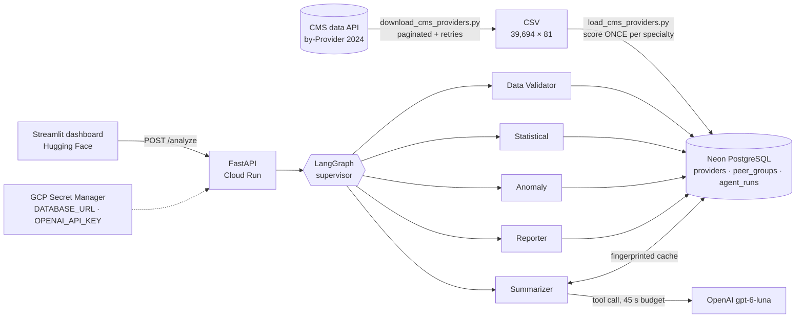
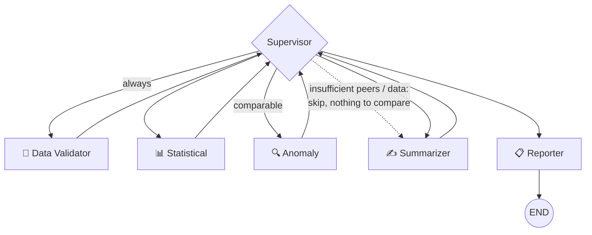

<div align="center">

# 🏥 CareAgent

### Multi-agent analysis of Medicare billing patterns on real CMS data

*A LangGraph pipeline of five agents compares each of **39,694 New Jersey Medicare providers** with peers in the same specialty, after adjusting for how sick their patients are. It flags unusual billing patterns with reasons computed from the data, and writes a plain-English summary that is checked number-by-number before it is shown.*

<br/>


<br/><br/>

[](https://huggingface.co/spaces/AhmeduddinMohammed/careagent)
[](https://careagent-api-668260909878.us-central1.run.app)
[](https://careagent-api-668260909878.us-central1.run.app/docs)

</div>

> [!IMPORTANT]
> **What this is and is not.** CareAgent compares Medicare *billing patterns* with same-specialty peers. Billing data contains no clinical outcomes, so this is **not a measure of quality of care**, and an outlier is **not evidence of fraud or wrongdoing**. Every scorecard carries this disclaimer. Provider names and street addresses are deliberately not stored.

---

## Contents

[Highlights](#-highlights--impact) · [Try it](#-try-it) · [Architecture](#-architecture) · [The comparison method](#-the-comparison-method) · [Results on real data](#-results-on-real-data) · [The agents](#-the-agents) · [LLM layer](#-llm-layer-grounded-cached-bounded) · [API](#-api) · [Production engineering](#-production-engineering) · [Testing](#-testing--ci) · [Design decisions](#-design-decisions) · [Quickstart](#-quickstart) · [Limitations](#limitations)

---

## ✨ Highlights & Impact

| | |
|---|---|
| 🏥 **Real data, full state** | **39,694** NJ providers (37,863 clinicians + 1,831 organizations) × 81 columns from the CMS *Medicare Physician & Other Practitioners – by Provider* 2024 release: **$4.78B** in Medicare payments, **155.8M** services. Pulled from the CMS API by a paginated, retrying downloader |
| 👥 **Peer groups** | **71** specialties with ≥30 providers (31 to 4,852 peers, median 261). **39,471** providers compared; 223 in smaller specialties are explicitly *not* compared rather than forced into an unreliable benchmark |
| ⚖️ **Risk-adjusted** | Cost and utilization adjusted for patient risk (CMS HCC score) with a regression fitted **within each specialty**: slopes range from −1.4 to +2.9, which is why one global adjustment would be wrong |
| 🚩 **Explainable outliers** | **1,461** outliers (**3.7%**) under a two-part rule: modified z > 3.5 **and** ≥ 2× the specialty median. Every flag names the metric, ratio and z-score that triggered it |
| 🌲 **Independent validation** | A per-specialty Isolation Forest ranks flagged providers at a median **96.4th** percentile of unusualness vs **48.2** for typical providers: two different methods agree |
| 🧠 **Grounded LLM** | gpt-6-luna writes the summary through tool calling; a **number check** rejects any narrative containing a figure not present in its input and falls back to a deterministic template |
| ⚡ **Fast and cheap** | Scores computed once at load, so each request is a few key lookups (**p50 26 ms** locally). Live with the LLM: ~3–5 s; repeat requests reuse a fingerprinted narrative: **0.83 s, 0 tokens (5.6× faster)** |
| 🛡️ **Hardened** | 45 s LLM time budget inside Cloud Run's 120 s limit, per-client rate limiting, transactional loads, idempotent migrations, no internal errors leaked to callers |
| ✅ **Tested** | **176 tests** (160 unit + 16 PostgreSQL integration), **98.7%** coverage of the *whole* package; CI runs integration tests against a Postgres service container and a blocking lint |

---

## 🚀 Try it

Open the **[dashboard](https://huggingface.co/spaces/AhmeduddinMohammed/careagent)** and enter one of these real NPIs, or call the API directly:

| NPI | Specialty | Result | Path through the agents |
|---|---|---|---|
| `1003049610` | Critical Care (Intensivists), 140 peers | 🟠 **outlier**: services per beneficiary 2.5× the median (modified z 3.9) | all 5 agents |
| `1003001678` | Nurse Practitioner, 4,852 peers | 🟢 **typical**: cost 0.7× median (31st percentile) | all 5 agents |
| `1003115387` | Advanced Heart Failure & Transplant Cardiology, 10 providers | ⚪ **insufficient peers** | supervisor **skips** the Anomaly agent |

```bash
curl -s -X POST https://careagent-api-668260909878.us-central1.run.app/analyze \
  -H "Content-Type: application/json" -d '{"npi":"1003049610"}'
```

---

## 🏗 Architecture



**Score once, read many.** Percentiles, z-scores and outlier thresholds only mean something against the *whole* peer group, so they are computed in one batch when data loads (~30 s locally, ~2 min into Neon, for all 39,694 providers). A request never refits a model; the agents read stored results and add the narrative.

---

## 📐 The comparison method

Implemented in [`src/careagent/scoring/peer.py`](src/careagent/scoring/peer.py), fitted separately for every specialty.

| Metric | Formula | Risk-adjusted |
|---|---|---|
| Cost per beneficiary | standardized Medicare payment ÷ beneficiaries (CMS standardization removes geographic pay differences) | ✅ |
| Services per beneficiary | services ÷ beneficiaries | ✅ |
| Charge-to-allowed ratio | submitted charges ÷ Medicare allowed amount | ❌ a pricing choice, not driven by patient risk |

1. **Risk adjustment.** Fit `log(metric) ~ log(average HCC risk score)` within the specialty. The observed ÷ expected (O/E) ratio is what is left after patient risk, so a provider with sicker patients isn't penalized for costing more. If every peer has the same risk score, the adjustment is skipped instead of fitting noise.
2. **Robust z-score.** Modified z = 0.6745 × (x − median) / MAD on log O/E (Iglewicz & Hoaglin). It uses median and MAD rather than mean and SD, so the outliers being hunted don't distort the yardstick. If MAD = 0, nobody is flagged on that metric.
3. **Outlier rule.** Modified z > 3.5 **and** ≥ 2× the specialty median, high side only. The second condition stops tight specialties from flagging trivial differences: without it, **39%** of Opioid Treatment Programs were flagged.
4. **Isolation Forest.** Fitted per specialty on the three log ratios. It *ranks* overall unusualness but does not decide the flag, so every flag stays explainable.
5. **Missing data stays missing.** No zero-filling, no imputation: a provider with a missing or invalid required field is reported as `insufficient_data`.

---

## 📊 Results on real data

| | |
|---|---|
| Providers loaded / compared | 39,694 / 39,471 |
| Specialty peer groups | 71 (31–4,852 peers, median 261) |
| Outliers | 1,461 (3.7%); per-specialty flag rate median 3.4%, max 13.6% |
| Reasons per outlier | 1 metric: 1,177 · 2 metrics: 281 · all 3: 3 |
| Triggered by | services 789 · cost 515 · charge ratio 444 |
| Isolation Forest percentile | outliers 96.4 vs typical 48.2 (medians) |

<details>
<summary>Largest specialties</summary>

| Specialty | Providers | Outliers | Rate |
|---|---:|---:|---:|
| Nurse Practitioner | 4,852 | 147 | 3.0% |
| Physical Therapist in Private Practice | 4,019 | 7 | 0.2% |
| Internal Medicine | 3,616 | 88 | 2.4% |
| Physician Assistant | 2,478 | 278 | 11.2% |
| Family Practice | 1,769 | 28 | 1.6% |
| Emergency Medicine | 1,339 | 51 | 3.8% |
| Chiropractic | 1,317 | 1 | 0.1% |
| Anesthesiology | 1,305 | 99 | 7.6% |

</details>

The most extreme case is an anesthesiologist billing services at **106.7×** the specialty median. Anesthesia is billed in time units, which is exactly why providers are only ever compared within their own specialty.

---

## 🤖 The agents

A LangGraph `StateGraph` with a shared, typed `AgentState`. The **supervisor** reads the state after every step and decides what runs next.



| Agent | Does |
|---|---|
| 🧹 **Data Validator** | Checks the 7 required fields are present and positive; lists any that aren't. Never imputes: an imputed median would make a provider look average |
| 📊 **Statistical** | Loads the provider's peer comparison (ratio to median, percentile, modified z per metric) and the specialty benchmarks |
| 🔍 **Anomaly** | Outlier flag, data-derived reasons, Isolation Forest percentile. **Skipped by the supervisor** when there is nothing to compare |
| ✍️ **Summarizer** | 2–3 sentence narrative from the LLM, number-checked and cached; deterministic template otherwise |
| 📋 **Reporter** | Final scorecard: `typical` / `outlier` / `insufficient_peers` / `insufficient_data` + disclaimer |

Two providers really take different paths: an outlier runs all five agents, while a provider in a 10-person specialty skips Anomaly and its scorecard explains why.

---

## 🧠 LLM layer: grounded, cached, bounded

| Concern | How it's handled |
|---|---|
| **Hallucinated numbers** | Every number in the narrative must match a number in the facts the model was given (±0.05); otherwise the narrative is rejected and the template is used. Small counting words (≤3) are allowed |
| **Unsafe framing** | Prompt forbids judging care quality or suggesting fraud; the disclaimer is appended by code, not by the model |
| **Structured output** | OpenAI tool calling with a forced function; JSON is parsed, never trusted blindly |
| **Model quirks** | gpt-6-luna only allows tools on Chat Completions with `reasoning_effort="none"`; it is sent by default and, if a model rejects `temperature` or `reasoning_effort`, the call is retried once without it. Any other error falls back to the template |
| **Cost and latency** | Narratives are stored with a SHA-256 fingerprint of *model + prompt version + facts* and reused while unchanged: **4.7 s → 0.83 s, 0 tokens**. Any change to the data, model or prompt invalidates it |
| **Time limits** | 20 s per attempt, no blind SDK retries, **45 s total**, well under Cloud Run's 120 s request limit |
| **Observability** | Narrative source (`llm` / `template`), `narrative_cached`, tokens and LLM calls are returned and logged per run in `agent_runs`; OpenAI's error message is logged (it never contains the key) |
| **No key / outage** | The pipeline still completes with a data-grounded template, labelled as such |

---

## 🔌 API

| Endpoint | Description |
|---|---|
| `POST /analyze` | Run the 5-agent pipeline for `{"npi": "<10 digits>"}` |
| `GET /health` | Database status, providers loaded / compared, outliers flagged, peer groups |
| `GET /` | Service info, data source, disclaimer and one real example NPI per status |
| `GET /docs` | Swagger UI |

<details>
<summary>Example response (abridged)</summary>

```json
{
  "npi": "1003049610",
  "provider_type": "Critical Care (Intensivists)",
  "city": "Pennington", "state": "NJ",
  "billing_pattern_status": "outlier",
  "peer_group_size": 140,
  "peer_comparison": {
    "cost":     {"ratio_to_peer_median": 1.069, "percentile": 60.7, "modified_z": 0.17},
    "services": {"ratio_to_peer_median": 2.45,  "percentile": 96.4, "modified_z": 3.87},
    "charge":   {"...": "..."}
  },
  "outlier_reasons": [
    "Risk-adjusted services per beneficiary is 2.5x the Critical Care (Intensivists) median (modified z = 3.9)"
  ],
  "narrative_source": "llm",
  "narrative_cached": false,
  "agents_executed": ["data_cleaner", "statistical", "anomaly", "summarizer", "reporter"],
  "agents_skipped": [],
  "disclaimer": "Compares Medicare billing patterns with same-specialty peers after adjusting for patient risk. It is not a measure of quality of care, and an outlier is not evidence of fraud or wrongdoing."
}
```
</details>

| Code | When |
|---|---|
| 200 | Scorecard |
| 404 | NPI not in the dataset |
| 422 | NPI not exactly 10 digits |
| 429 | More than 20 `/analyze` requests per minute from one client (`Retry-After` header) |
| 500 | Pipeline failure. Returns a run ID only; details go to logs and `agent_runs`, never to the caller |

---

## 🛠 Production engineering

**Deployment**

| Component | Where |
|---|---|
| API | FastAPI in Docker on **GCP Cloud Run** (us-central1), built by Cloud Build from source, image in Artifact Registry; scales 0 → 2 instances |
| Secrets | `DATABASE_URL` and `OPENAI_API_KEY` in **GCP Secret Manager**, mounted as env vars; the runtime service account has `secretAccessor` on exactly those two |
| Database | **Neon** serverless PostgreSQL (pooled connection, TLS required) |
| Dashboard | Streamlit in a Docker Space on **Hugging Face**, calling the API |
| Cost control | $5 GCP budget alert; per-client rate limit and narrative cache bound LLM spend |

**Robustness**

- **Rate limiting:** sliding window, 20 `/analyze` per minute per client IP; the real client is the *last* `X-Forwarded-For` hop, so callers can't spoof it. Blocked requests never reach the pipeline. `/health` and `/` are not limited.
- **Transactional loads:** the loader replaces data in one transaction, so an interrupted load rolls back cleanly, and re-running never duplicates. Duplicate or malformed NPIs stop the load *before* any data is touched.
- **Migrations:** `create_tables()` is idempotent and adds columns introduced by later versions; `--reset-schema` upgrades a v1 database.
- **Configuration:** one `DATABASE_URL` (normalized to the psycopg2 driver) or `POSTGRES_*` + `POSTGRES_SSLMODE`; unknown variables from older configs are ignored instead of crashing startup.
- **Error hygiene:** callers get a run ID, never exception text (which can contain hostnames); full details go to the logs.
- **Safety rails:** integration tests run only with `RUN_INTEGRATION=1` *and* a localhost database, so a test run can never wipe production.

---

## ✅ Testing & CI

| Suite | Tests | Covers |
|---|---:|---|
| Peer scoring | 28 | metrics, risk adjustment recovers a planted slope, MAD = 0, identical risk scores, low-side not flagged, the 2× gate, determinism, Isolation Forest ranks planted outliers ≥95th |
| Edge cases | 38 | NPI validation, LLM time budget, narrative cache and invalidation, rate limiter (fake clock), spoofed `X-Forwarded-For`, 429 + `Retry-After` |
| Agents & routing | 22 | each agent with a mocked DB, supervisor paths incl. the Anomaly skip |
| LLM | 39 | number check, tool call, `temperature` / `reasoning_effort` retries, the exact gpt-6-luna error, fallbacks, ordinals |
| API, config, loader | 33 | status codes, no error leakage, health/root during outages, connection strings, row conversion |
| **PostgreSQL integration** | 16 | real load → LangGraph → API → database round trips, idempotent migration, cache across runs, duplicate-NPI rejection leaves data untouched |
| **Total** | **176** | **98.7%** line coverage of the whole `careagent` package |

GitHub Actions runs on every push and PR: all tests against a **Postgres 16 service container** with an 85% whole-package coverage gate, plus a blocking `ruff` lint (pinned version).

---

## 🧭 Design decisions

This project began as a synthetic-data prototype. Rebuilding it on real data meant fixing several things that would not survive scrutiny:

| Before (v1) | Problem | Now (v2) |
|---|---|---|
| 10,000 synthetic providers | Not real; one NPI had many names | 39,694 real NJ providers from the CMS API |
| "Quality score" + include/exclude recommendation | Billing data has no quality outcomes | `billing_pattern_status` + disclaimer; no names stored |
| One Isolation Forest across all specialties, refit per request | Specialty dominated the result; slow; non-reproducible | Per-specialty comparison scored once at load |
| No risk adjustment | Penalized providers with sicker patients | Within-specialty regression on the HCC risk score |
| Missing values → 0 | Missing data looked "cheap" | Missing stays missing → `insufficient_data` |
| Hard-coded anomaly reasons; flag rate fixed by `contamination` | Reasons not tied to the data; circular | Reasons computed per metric; flag rate is an *outcome* (3.7%) |
| Charge/payment ratio compared to charge/allowed benchmark | Mismatched units | Each metric compared with its own specialty median |
| Coverage measured on 2 files; integration tests always skipped | Misleading numbers | Whole-package coverage; integration tests run in CI |
| Unused deps (ragas, mlflow, …) | Claims the code didn't back | Removed; dashboard deps in an optional extra |

---

## ⚡ Quickstart

```bash
git clone https://github.com/MohammedAhmeduddin/careagent && cd careagent
python3.11 -m venv .venv && source .venv/bin/activate
pip install -e ".[dev,dashboard]"
cp .env.example .env            # local Docker Postgres: POSTGRES_PORT=5433, POSTGRES_SSLMODE=disable

docker compose up -d postgres
python scripts/download_cms_providers.py --state NJ        # ~15 MB from data.cms.gov
python scripts/load_cms_providers.py --csv data/raw/cms_providers_NJ_2024.csv

PYTHONPATH=src:. pytest                                    # unit tests
RUN_INTEGRATION=1 PYTHONPATH=src:. pytest                  # + integration (LOCAL db only: replaces data)

uvicorn careagent.api.main:app --app-dir src --port 8080
CAREAGENT_API=http://localhost:8080 streamlit run app.py
```

Any state works (`--state CA`). Upgrading a v1 database needs `--reset-schema` once.

<details>
<summary>Deploy to Cloud Run</summary>

```bash
printf %s "$DATABASE_URL"   | gcloud secrets create careagent-database-url --data-file=-
printf %s "$OPENAI_API_KEY" | gcloud secrets create openai-api-key --data-file=-
# grant roles/secretmanager.secretAccessor on both to the runtime service account

gcloud run deploy careagent-api --source . --region us-central1 --allow-unauthenticated \
  --set-secrets "DATABASE_URL=careagent-database-url:latest,OPENAI_API_KEY=openai-api-key:latest" \
  --set-env-vars "LOG_LEVEL=INFO,APP_ENV=production" \
  --min-instances 0 --max-instances 2 --memory 1Gi --cpu 1 --timeout 120
```
</details>

<details>
<summary>Configuration</summary>

| Variable | Default | Purpose |
|---|---|---|
| `DATABASE_URL` | – | Full connection string (overrides `POSTGRES_*`) |
| `POSTGRES_SSLMODE` | `require` | `disable` for a local Postgres without TLS |
| `OPENAI_API_KEY` | – | Without it, narratives use the template |
| `OPENAI_MODEL` | `gpt-6-luna` | Narrative model |
| `OPENAI_REASONING_EFFORT` | `none` | Required by gpt-6-luna for tool calls; `""` to omit |
| `OPENAI_TIMEOUT_SECONDS` / `OPENAI_TOTAL_BUDGET_SECONDS` | `20` / `45` | Per-attempt and total LLM time |
| `RATE_LIMIT_PER_MINUTE` | `20` | Per-client limit on `/analyze` (0 disables) |
</details>

---

## 📁 Project structure

```
src/careagent/
├── scoring/peer.py      # metrics, risk adjustment, robust z, outlier rule, Isolation Forest, NPI checks
├── scoring/load.py      # scored DataFrame → database rows
├── agents/              # supervisor + data validator, statistical, anomaly, summarizer, reporter
├── graph/               # AgentState contract + LangGraph wiring
├── db/                  # SQLAlchemy models (providers, peer_groups, agent_runs), queries, session, migrations
├── api/                 # FastAPI app, routes, schemas, rate limiter
└── config.py
scripts/download_cms_providers.py   # CMS API → CSV (paginated, retries)
scripts/load_cms_providers.py       # CSV → score → Postgres
app.py                              # Streamlit dashboard (also deployed to Hugging Face)
tests/unit · tests/integration      # 160 + 16 tests
```

---

## Limitations

- **Billing, not quality.** No outcomes, readmissions or patient experience are in the data.
- **Medicare fee-for-service only.** Medicare Advantage and commercial patients are invisible; a provider with few traditional Medicare patients may look unusual for that reason alone.
- **Specialty is self-reported** and broad; sub-specialists (e.g. interventional vs general cardiology) can differ legitimately inside one group.
- **Services are counted as CMS reports them** (anesthesia in time units), which is why comparisons never cross specialties.
- **CMS suppresses small cells** (<11 beneficiaries), so very low-volume providers are absent.
- **Rate limiting is per instance** (in-memory); a shared store such as Redis or Cloud Armor would be the multi-instance version.

## 📄 Data

[CMS Medicare Physician & Other Practitioners – by Provider](https://data.cms.gov/provider-summary-by-type-of-service/medicare-physician-other-practitioners/medicare-physician-other-practitioners-by-provider), 2024 data year, New Jersey. Public data. The raw CSV is not committed (`data/` is gitignored); the downloader recreates it.

---

<div align="center">

**Mohammed Ahmeduddin** · [GitHub](https://github.com/MohammedAhmeduddin) · [LinkedIn](https://www.linkedin.com/in/mohammed-ahmeduddin/)

Other projects: [LoanLens](https://huggingface.co/spaces/AhmeduddinMohammed/loanlens) · [SessionScout](https://huggingface.co/spaces/AhmeduddinMohammed/sessionscout)

</div>
